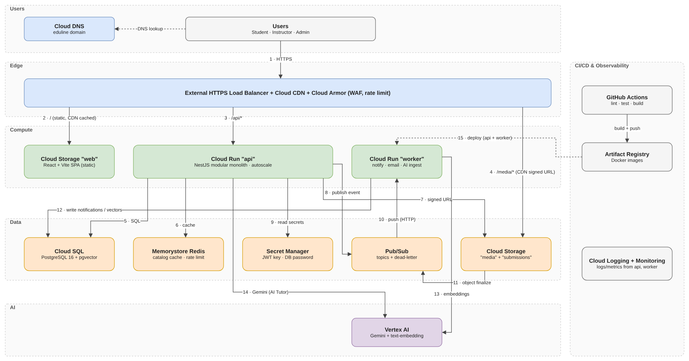

# Architecture Overview (M1, Week 1)

Source: [`architecture.drawio`](architecture.drawio). Arrow numbers below match the diagram.

## Components and owners

| Layer | Component | GCP service | Owner | Details |
|---|---|---|---|---|
| Edge | Load balancer, CDN, WAF | External HTTPS LB + Cloud CDN + Cloud Armor, Cloud DNS | M1, M5 | [storage-cdn-iam.md](storage-cdn-iam.md) |
| Frontend | React + Vite SPA (static files) | Cloud Storage bucket `eduline-web` | M4 | [ADR-007](architecture-decisions.md#adr-007-frontend-as-a-static-spa-on-cloud-storage--cdn) |
| Backend | API, NestJS modular monolith | Cloud Run `api` | M2, M3 | [backend/README.md](../backend/README.md) |
| Backend | Worker (notifications, email, AI ingest) | Cloud Run `worker` | M6 | [ADR-005](architecture-decisions.md#adr-005-notifications-are-asynchronous-pubsub--outbox) |
| Data | Transactional DB + vectors | Cloud SQL PostgreSQL 16 + pgvector | M2, M5 | [ADR-003](architecture-decisions.md#adr-003-postgresql-not-mongodb-and-pgvector-not-a-separate-vector-db) |
| Data | Cache, rate limit | Memorystore Redis (only if measured need) | M2, M5 | [ADR-006](architecture-decisions.md#adr-006-cache-only-shared-read-heavy-data-and-measure-first) |
| Data | Media and submissions | Cloud Storage `eduline-media`, `eduline-submissions` | M6 | [storage-cdn-iam.md](storage-cdn-iam.md) |
| Messaging | Events | Pub/Sub (+ dead-letter topic) | M6 | ADR-005 |
| Security | Secrets | Secret Manager | M5 | [security-checklist.md](security-checklist.md) |
| AI | LLM + embeddings | Vertex AI (Gemini, text-embedding) | M6 | |
| Ops | CI/CD, logs, metrics | GitHub Actions → Artifact Registry → Cloud Run; Cloud Logging + Monitoring | M5 | |

## Arrows

| # | From → To | Meaning |
|---|---|---|
| 1 | Users → LB | HTTPS (domain resolved by Cloud DNS) |
| 2 | LB → `eduline-web` | `/` static SPA, cached at the CDN |
| 3 | LB → `api` | `/api/*` |
| 4 | LB → `eduline-media` | `/media/*` with CDN signed URLs |
| 5 | api → Cloud SQL | SQL through the Cloud SQL connector |
| 6 | api → Redis | catalog / outline cache |
| 7 | api → Cloud Storage | sign upload/download URLs |
| 8 | api → Pub/Sub | publish events (via outbox) |
| 9 | api → Secret Manager | DB password, JWT secret, CDN key |
| 10 | Pub/Sub → worker | push over HTTP (OIDC) |
| 11 | Cloud Storage → Pub/Sub | object finalize (new PDF → AI ingest) |
| 12 | worker → Cloud SQL | write notifications, document vectors |
| 13 | worker → Vertex AI | embeddings |
| 14 | api → Vertex AI | Gemini answer for the AI tutor |
| 15 | GitHub Actions → Artifact Registry → Cloud Run | build and deploy `api`, `worker` |

## Main flows

| Flow | Steps | Detail |
|---|---|---|
| Browse catalog | Browser → LB (CDN for anonymous GET) → api → cache hit, or Cloud SQL then cache | ADR-006 |
| Upload video/PDF | Instructor → api signs PUT → browser uploads to GCS → api `/complete` verifies size/type → saves key | storage doc §3 |
| Open lesson | Student → api `canViewContent`? no → 403; yes → CDN signed URL → video from CDN edge | storage doc §4 |
| Save progress | Player sends `VIDEO_PROGRESS` → api → Cloud SQL (never cached) | M3 |
| Submit quiz | api claims attempt with a conditional update → score in one transaction → result | [quiz-submission-design.md](quiz-submission-design.md) |
| Notification | Grade → transaction (submission + outbox) → Pub/Sub → worker → `notifications` (+ email) | ADR-005 |
| AI tutor | Index: PDF → finalize → Pub/Sub → worker (text → chunks → embeddings → pgvector). Ask: api checks access → retrieve `WHERE course_id` → Gemini → answer + citations | M6 |
